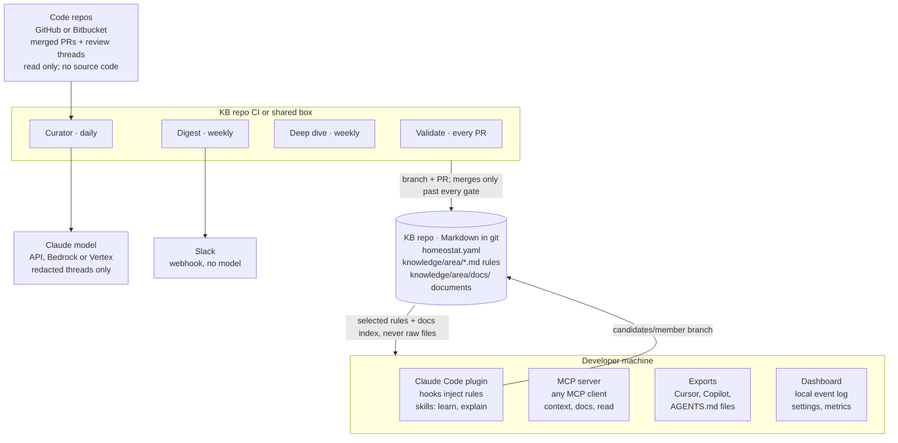

# Homeostat: technical design

As of 2026-10-15, version 0.1.0. For the threat model see [security.md](security.md); for every config key, [guide/config.md](guide/config.md).

## Overview

Homeostat turns a team's accepted code-review feedback into short, scored rules and sectioned team documents. It stores them as Markdown in a git repo, changes them only by pull request, and gives every coding agent the ones that apply to the files it is touching. Version 0.1.0 is on npm as `homeostat`, Apache-2.0, TypeScript on Node 22.18+.

**Problem.** Reviewers teach agents the same lessons repeatedly, because agent memory is per session, per person and per tool. Claude Code's own memory is unreviewed, not shared across tools, and has no provenance.

**Goals**

- Capture lessons automatically from review threads that led to a code change, and by hand from sessions.
- Govern them like code: scored, validated, owned by a team, merged by PR.
- Deliver them to Claude Code, any MCP client, Cursor, Copilot and AGENTS.md, within a token budget.
- Make the data path auditable enough for a security review.

**Non-goals:** a hosted service, a vector database, per-laptop daemons, reading source code during normal operation.

**Hard constraints**

- Nothing scheduled runs on a developer's laptop. The agents run in the KB repo's CI or on one shared box.
- The agents read many repos but write only to the KB repo, and only by branch and PR.
- No secrets or company-specific content in the public repo; new dependencies need approval.

## Architecture

Three places run Homeostat, and only the KB repo holds state. The agents in CI read the code repos and write only to the KB repo, by pull request. Developer machines read a checkout of the KB repo; nothing scheduled runs there.

The curator sends the model redacted review threads, never code. Sessions get a rendered, selected view. A developer's lessons travel back only as a `candidates/<member>` branch.

| Package | Runs where | Role |
| --- | --- | --- |
| `@homeostat/core` | everywhere | pure logic: schema, validation, scoring, selection, scanners, curator, deep dive, providers, export |
| `homeostat` (CLI) | CI, shared box, laptops | commands, hook handlers, git and PR plumbing |
| `@homeostat/mcp` | laptops (stdio) | MCP server over the KB |
| `@homeostat/dashboard` | loopback on one machine | metrics and settings forms |
| `packages/plugin` | Claude Code | skills, SessionStart and Stop hooks, `.mcp.json` |

## Knowledge model

The KB is a git repo: `homeostat.yaml` at the root, rules at `knowledge/<area>/<id>.md`, documents at `knowledge/<area>/docs/<topic>.md`. Areas map names to path globs in the code repos; `core` applies everywhere.

**Rules** are one instruction each. YAML frontmatter holds machine fields, the body holds what agents read:

| Part | Contents |
| --- | --- |
| Identity | `id`, `title` (≤80 chars), `area`, `scope` (path globs) |
| Lifecycle | `status`: candidate → accepted → disputed → retired; `approvedBy`, `flags` |
| Provenance | `source.type` (pr-feedback, manual, agent-handoff, deep-dive), `url`, `author`, `changedCode`, `created`, `lastConfirmed` |
| Kind | optional `kind` (convention, anti-pattern, migration, legacy, tech-debt, practice, review-lesson, decision); `adopted: false` marks a rejected decision |
| Cached | `score`, `tokens` (recomputed by `validate --fix`) |
| Body | `## Rule` ≤60 words, `## Why` ≤100 words, optional `## Example` |

**Documents** hold reference knowledge too long for a rule. Frontmatter: `title`, `area`, `owner`, `scope`, `updated`. The body is `## Heading {#id}` sections, each starting with `<!-- homeostat: source=… url=… updated=… confidence=… -->`. Stable ids let agents read and patch one section.

**Scoring** is computed, never hand-set: +3 review feedback followed by a code change, +2 written by hand, +1 senior author, −2 per conflict, −2 per open flag. All weights live in `scoring.weights`.

**Config** (`homeostat.yaml`, zod-validated) covers team members and teams, areas, scoring and auto-merge gates, agent runtimes and schedules, token budgets, notifications, security switches and git sources.

## Capture

Knowledge enters by four paths. All of them end as a branch and a pull request on the KB repo, never a direct write to `main`.

**Curator** (`homeostat curate`, daily in CI) runs this pipeline:

1. List PRs merged in `sources.repos` within `lookbackHours` (26). Skip PRs marked `homeostat:skip`, excluded repos, and authors who opted out.
2. Group review comments into threads. Keep a thread only if a team member wrote it, a commit followed it, it isn't in an excluded path, and it isn't already cited by a rule or document section.
3. Redact secrets from the thread, then ask the model for one rule (structured output: keep, title, rule, why, area).
4. If a document's scope covers the commented file, ask for at most one section patch (replace or append) with `source=curator` provenance.
5. Build the entry, compute its score, and validate it against the whole KB. Risky-content findings keep a draft as a flagged candidate; any other error drops it.
6. Split the results by the auto-merge gates. Passing rules go in an auto-merge PR; everything else, and every document patch, goes in a review PR.
7. Open a PR for each pushed `candidates/<member>` branch, marked as written by an agent.

**By hand.** `homeostat learn` writes a candidate from flags, prompts or a review-comment URL. The URL route fetches the comment and detects whether code changed after it. `learn --doc <area>/<topic> --section <id>` patches one document section. `/homeostat:learn` drafts from a session and asks before writing.

**Handoff notes.** The plugin's Stop hook counts edits in a session. After `handoff.minEdits` (5), it asks the agent once for a note, committed with `--source agent-handoff` to `candidates/<member>`.

**Seed** (`homeostat seed <checkout>`, manual only). It scans a local repo's tracked paths and key files (≤400 paths, 6 KB per file, 60 KB total), redacts secrets, and drafts architecture, conventions or cross-repo documents, one PR each, every section marked `source=seed`.

**Section patches** are byte-safe. `applySectionPatch` replaces, appends to or adds exactly one section, keeps every other byte, bumps `updated`, and refuses a patch that would break the document.

## Governance

Every change passes `homeostat validate`, which CI runs on each KB pull request. Validation is pure: it takes a map of files and returns issues, so the CLI, curator, MCP server and dashboard share it.

| Check | Catches | Result |
| --- | --- | --- |
| Schema | frontmatter shape, word limits, ids, dates, unknown keys | error |
| Config cross-checks | unknown areas, members, owners; one owning team per area | error |
| Secret scanner | cloud, git-host, Slack and AI keys, JWTs, private keys, credentialed URLs, passwords, high-entropy strings | error |
| Emails | personal data in rule text | warning |
| Risky content | piped shell, unlisted domains, credential handling, disabling security checks, injection phrasing, destructive commands, hidden text | error until `riskReviewedBy` |
| Provenance | a pr-feedback URL outside `sources.repos` | error |
| Documents | duplicate headings or ids, repeated dates, wrapped or unclosed fences, conflict markers, sections over 400 words | error or warning |
| Conflicts | duplicate ids, near-duplicates, declared contradictions | error or warning |

**Auto-merge.** A rule merges without a reviewer only when every gate passes:

- its score reaches the threshold (3)
- it is review feedback from a member, followed by a code change
- it has no flags and no risky-content findings
- its area is in `scoring.autoMerge` scope, within `maxPerRun` (5)

The curator then validates the merged KB and squash-merges through the host API. If the host refuses, the PR stays open. Agent-written entries, deep-dive edits and document patches never auto-merge.

**Deep dive** (weekly) merges near-duplicate rules into the higher-scoring one, asks the model about contradictions with the week's new rules, and retires rules unconfirmed for `staleAfterDays` (180). It notes document coverage gaps and stale sections, but never edits documents.

**Ownership.** `homeostat codeowners` generates CODEOWNERS. Each area goes to its owning team's handle (or its members), and seniors own the config and core. Reads stay org-wide: any session gets any team's rule whose scope matches its files.

## Delivery

Agents never read the stored files. They get a rendered view: no frontmatter, only the rules and sections that apply, under a token budget.

**Session start** (Claude Code plugin, SessionStart hook):

1. Find the KB from the plugin's `kb_dir` setting, then `$HOMEOSTAT_DIR`, then the current repo.
2. Collect touched paths from `git status` and recent commits.
3. Select accepted rules whose scope matches, minus rejected decisions and other teams' team-only areas. Rank by score, then path match over global, then last confirmed.
4. Fit them into `distribution.tokenBudget` (2,000). Each rule goes in whole, else rule-only, else dropped, capped at 10,000 characters.
5. Group by kind under one guidance line each, and add the context header (rules never override the user or safety).
6. Add a documents index and the sections that name a touched path, within `docTokenBudget` (1,000).
7. Log an `injection` event.

**MCP server** (`homeostat mcp`, stdio) re-reads the KB on every call:

| Tool | Purpose |
| --- | --- |
| `context` | rules for given files, within a budget |
| `search` | keyword search, local, no model call; rejected decisions shown as context |
| `explain` | source, score breakdown, owner, conflicts |
| `docs`, `read` | list documents; read one, or one section, with its source |
| `report` | KB health over recent days |
| `learn`, `flag` | off unless `security.mcpWrites`; then at most `mcpWriteLimit` (5) per session |

Guessed tool names (`get_rules`, `remember`, `open`, …) resolve through an alias table and are logged as desire paths.

**Exports** (`homeostat export`) write each tool's native, path-scoped format into a code repo:

- Claude rules with `paths:` under `.claude/rules/homeostat/`
- Cursor `.mdc` files with `globs`
- Copilot instructions with `applyTo`, plus a block in `copilot-instructions.md`
- a marked AGENTS.md block, with documents under `.agents/homeostat/`

`--check` fails CI when they're stale. Team-only areas and rejected decisions are never exported, and public repos need `--allow-public`.

**Why this shape.** Measured on Claude, a lean Markdown render costs 1.0×, YAML or minified JSON 1.34×, the stored files with frontmatter 2.9×. Accuracy was identical across formats up to about 150k tokens, so selection and caching matter more than syntax.

## Security and data handling

The main threat is knowledge poisoning: one merged rule reaches every developer's agent, so a rule is effectively a prompt. Controls follow the data path.

| Data | Leaves the network? | Control |
| --- | --- | --- |
| Review threads (comment, PR title, file, line) | to the chosen model runtime | secrets redacted first; `--show-prompts` prints all, sends nothing; exclusions, skip marker, opt-out |
| Source code | only via manual `seed` | dry run; exclusions; redaction; never scheduled |
| KB content | to sessions and exports | team-only areas; public-repo guard on export |
| Local events (`.homeostat/events.db`) | never | git-ignored; size-only model-call logs; pruned after 90 days |
| Tokens | stay in CI secrets | never in files, prompts or logs; `doctor` checks their reach |

**Against poisoning:**

- the risky-content linter
- the auto-merge gates
- the provenance check
- agent-written entries capped at score 0 and labelled
- MCP writes off by default
- a session header that says rules never override the user or safety

**On laptops** the hooks and MCP server make no network calls, except pushing a candidate branch with the developer's own credentials. The dashboard binds to loopback, loads nothing external, and checks a per-run token plus Host and Origin on writes.

**Review package:** [data-handling.md](data-handling.md) (one page), [SECURITY.md](../SECURITY.md) (private advisories), and `homeostat doctor --security`. Doctor answers what is read, what leaves, who can change the rules, and the blast radius, against the live setup (branch protection, token write reach, KB visibility, pinned versions, runtime, exclusions, retention).

## Operations

**Model runtimes** sit behind one `Asker` interface (system, user, zod schema → typed result or null):

| Runtime | Path | Structured output |
| --- | --- | --- |
| `api` (default) | `@anthropic-ai/sdk`, Console key | `beta.messages.parse` with zod, server-side refusal fallback |
| `bedrock` | `AnthropicBedrockMantle`, AWS credential chain | one forced tool call |
| `vertex` | `AnthropicVertex`, Google ADC | one forced tool call |
| `claude-code` | `claude -p` with `--json-schema`, tools off | CLI schema; personal or Team/Enterprise plans only |

The default model is `claude-opus-5-5` at `medium` effort, configurable per agent. The cloud SDKs are optional peers, loaded only when chosen. Every call logs a `model-call` event with its size, never its content. See [runtimes.md](runtimes.md).

**Scheduling.** `init` writes the CI jobs: validate on every PR, the curator daily, the deep dive weekly, and a weekly read-only digest (GitHub Actions or Bitbucket Pipelines). `homeostat up` is the alternative for one shared box or the Docker image. It runs the same agents and the digest on their cron schedules, and serves the dashboard.

**Event log.** SQLite through `node:sqlite` at `.homeostat/events.db`, local to each machine. It records injections, MCP calls and desire paths, captures, flags, agent runs, model calls, document reads and auto-merges. It feeds `homeostat events`, `status`, the dashboard and the digest.

**Dashboard.** Server-rendered HTML with inline SVG charts, no framework. Pages: overview and agent liveness, entries, members, coverage, impact, documents (section use and decay), desire paths, events, and settings forms for every config key (a test enforces that).

**Digest.** `homeostat digest` builds a Slack message without a model: new and reconfirmed rules, rejected decisions, updated sections, the review queue, flags and guessed tool names. It posts to the webhook named by `notifications.slackWebhookEnv`.

## Release and supply chain

Homeostat runs in every developer's session and in CI with tokens, so a compromised release is a top-tier risk. Releases are pinned, signed and small. See [releasing.md](releasing.md).

- **One exact version everywhere.** `scripts/version.mjs` sets it in every package, the plugin manifest, core's `VERSION`, the skills and docs. A test fails on drift or on any floating range. The plugin's npx fallback runs its own version, and `init` writes the exact version into CI.
- **Provenance.** A `v*` tag runs `release.yml` behind a required-reviewer `npm` environment. It checks the tag matches the version, runs the full check and `pnpm audit`, packs four packages, builds a CycloneDX SBOM, publishes with npm trusted publishing (OIDC, no stored token) and SLSA provenance, and attaches tarballs and SBOM to a GitHub release. 0.1.0 shipped this way on 2026-10-14.
- **Runnable from source and from npm.** The bin runs TypeScript directly in a checkout (Node type stripping, `erasableSyntaxOnly`), and the compiled `dist/` when installed under `node_modules`.
- **Few dependencies:** zod, yaml, commander, minimatch, js-tiktoken, `@anthropic-ai/sdk`, the MCP SDK, plus optional Bedrock and Vertex SDKs. Renovate and pnpm `minimumReleaseAge` wait three days before taking a new version, and CI actions are pinned to commit SHAs.

| Package | Contents |
| --- | --- |
| `homeostat` | CLI and hook handlers; the only package users install |
| `@homeostat/core` | schemas, validation, scoring, selection, scanners, agents, providers, export |
| `@homeostat/mcp` | MCP server |
| `@homeostat/dashboard` | local dashboard |
| `packages/plugin` | Claude Code plugin (skills, hooks, `.mcp.json`), installed from the repo's marketplace |

## Decisions and open questions

| Decision | Why | Trade-off |
| --- | --- | --- |
| Markdown in git as the store | reviewable, diffable, works with CODEOWNERS and PRs; no service to run | agents need a rendered view, not the files |
| Rendered, selected view for agents | measured 2.9× cheaper than the raw files, same accuracy; less context rot | rules outside the budget reach the session only through MCP |
| Keyword search, no embeddings | no model or index to host; plain-file retrieval matches specialised memory on benchmarks | weaker on paraphrased queries |
| Agents in CI, not on laptops | no daemons, one place holding tokens | lessons arrive daily, not live |
| Guarded auto-merge | high-signal feedback lands without review toil | relies on gates and branch protection being right |
| Section-level document edits | whole-file rewrites caused most of the pilot's document damage | bigger changes take several patches |
| TypeScript, one pnpm monorepo | one language for CLI, MCP, plugin and dashboard; npx install | no Python SDK users |
| Default runtime `api`, cloud runtimes optional | team-safe terms; data can stay in AWS or Google Cloud | three code paths to keep working |

**Open questions**

- Should `scope` accept language or framework selectors (`lang:ts`) as well as path globs?
- Is `score` enough, or should a separate confidence be added?
- Should the deep dive re-check document sections against code? That needs code access, which only `seed` has today.
- The event log is per machine, so usage and decay reflect one developer. Should there be an opt-in shared aggregate?
- `scoring.reviewCadence` is defined but not used yet.
- Not yet verified live: Bedrock and Vertex runs, a real Slack digest, and Cursor and Claude Desktop checks.
