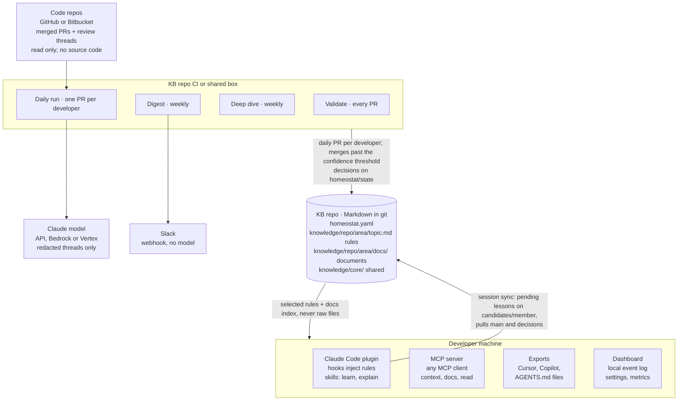

# Homeostat: technical design

As of 2026-10-21, version 0.2.1. For the threat model see [security.md](security.md); for every config key, [guide/config.md](guide/config.md).

## Overview

Homeostat turns a team's accepted code-review feedback into short, scored rules and sectioned team documents. It stores them as Markdown in a git repo, changes them only by pull request, and gives every coding agent the ones that apply to the files it is touching. It is on npm as `homeostat`, Apache-2.0, TypeScript on Node 22.18+. 0.2 added knowledge bases for several code repos, rules grouped into topic files, and `homeostat bootstrap`.

**Problem.** Reviewers teach agents the same lessons repeatedly, because agent memory is per session, per person and per tool. Claude Code's own memory is unreviewed, not shared across tools, and has no provenance.

**Goals**

- Capture lessons automatically from review threads that led to a code change, and by hand from sessions.
- Govern them like code: scored, validated, owned by a team, merged by PR.
- Deliver them to Claude Code, any MCP client, Cursor, Copilot and AGENTS.md, within a token budget.
- Make the data path auditable enough for a security review.

**Non-goals:** a hosted service, a vector database, per-laptop daemons, reading source code during normal operation (only `bootstrap` and `seed`, run by hand, read it).

**Hard constraints**

- Nothing scheduled runs on a developer's laptop. The agents run in the KB repo's CI or on one shared box.
- The agents read many repos but write only to the KB repo, and only by branch and PR.
- No secrets or company-specific content in the public repo; new dependencies need approval.

## Architecture

Three places run Homeostat, and only the KB repo holds state. The agents in CI read the code repos and write only to the KB repo, by pull request. Developer machines read a checkout of the KB repo; nothing scheduled runs there. Their sessions sync it in the background instead (see [Automation](#automation)).

The daily run sends the model redacted review threads, never code. Sessions get a rendered, selected view. A developer's lessons travel back only as a `candidates/<member>` branch.

| Package | Runs where | Role |
| --- | --- | --- |
| `@homeostat/core` | everywhere | pure logic: schema, validation, scoring, selection, scanners, the daily run's drafting, deep dive, bootstrap, providers, export |
| `homeostat` (CLI) | CI, shared box, laptops | commands, hook handlers, git and PR plumbing |
| `@homeostat/mcp` | laptops (stdio) | MCP server over the KB |
| `@homeostat/dashboard` | loopback on one machine | metrics and settings forms |
| `packages/plugin` | Claude Code | skills, SessionStart and Stop hooks, `.mcp.json` |

## Knowledge model

The KB is a git repo: `homeostat.yaml` at the root, rules under `knowledge/<area>/`, documents at `knowledge/<area>/docs/<topic>.md`. Areas map names to path globs in the code repos; `core` applies everywhere.

- **Repo folders** (optional): a KB serving several code repos lists them under `repos`, each with its own areas, and keeps each repo's knowledge in `knowledge/<repo>/<area>/`. Shared rules stay in `knowledge/core/`. Sessions, MCP and exports see their own repo plus core, found from the checkout's `origin` remote (or its folder name), and duplicates are compared only within a repo or against core.
- **Topic files** (optional): with a `topics` list, rules are grouped into `<area>/<topic>.md`, one `## Title {#id}` section per rule with its fields in a `<!-- homeostat … -->` YAML comment. Each section is read as a rule at a virtual path `<area>/<id>.md`, so validation, scoring and selection have one code path. Writers merge sections into the file sorted by id, and a conflicting PR is rebuilt from both sides. Without topics, each rule is its own file `<area>/<id>.md`.

**Rules** are one instruction each. YAML frontmatter holds machine fields, the body holds what agents read:

| Part | Contents |
| --- | --- |
| Identity | `id`, `title` (≤80 chars), `area`, `scope` (path globs), `topic` in a topic file |
| Lifecycle | `status`: candidate → accepted → disputed → retired; `approvedBy`, `flags` |
| Provenance | `source.type` (pr-feedback, manual, agent-handoff, deep-dive), `url`, `author`, `changedCode`, `alsoFrom` (later lessons folded in), `created`, `lastConfirmed` |
| Kind | optional `kind` (convention, anti-pattern, migration, legacy, tech-debt, practice, review-lesson, decision); `adopted: false` marks a rejected decision |
| Cached | `score`, `tokens` (recomputed by `validate --fix`) |
| Body | `## Rule` ≤60 words, `## Why` ≤100 words, optional `## Example` |

**Documents** hold reference knowledge too long for a rule. Frontmatter: `title`, `area`, `owner`, `scope`, `updated`. The body is `## Heading {#id}` sections, each starting with `<!-- homeostat: source=… url=… updated=… confidence=… -->`. Stable ids let agents read and patch one section.

**Scoring** is computed, never hand-set: +3 review feedback followed by a code change, +2 written by hand, +1 senior author, −2 per conflict, −2 per open flag. All weights live in `scoring.weights`. The daily run decides with a separate 0–100 **confidence** (see [Automation](#automation)).

**Config** (`homeostat.yaml`, zod-validated) covers team members, teams and named reviewers, the code repos with their areas and topics (or one set of areas), scoring and auto-merge gates, agent runtimes and schedules, token budgets, notifications, security switches and git sources.

## Capture

Knowledge enters by four paths. All of them reach `main` only through the daily run's pull requests, never by a direct write.

**From reviews** (part of `homeostat daily`; `homeostat curate` runs the same pipeline on its own):

1. List PRs merged in the KB's code repos (`repos`, or `sources.repos` in a KB without repo folders) within `lookbackHours` (26). Skip PRs marked `homeostat:skip`, excluded repos, and authors who opted out.
2. Group review comments into threads (the KB repo is never read as a code repo, even if listed: its PRs are Homeostat's own output). Keep a thread only if a team member wrote it, a commit followed it, it isn't in an excluded path, and it isn't already cited by a rule or document section, on the base branch or in an open review PR.
3. Redact secrets from the thread, then ask the model for one rule (structured output: keep, title, rule, why, area, and topic from the repo's list, or a suggested new one).
4. If a document's scope covers the commented file, ask for at most one section patch (replace or append) with `source=curator` provenance.
5. Build the entry, compute its score, and validate it against the whole KB. Risky-content findings keep a draft as a flagged candidate; any other error drops it.
6. File the lesson under the repo the PR came from and the developer whose PR it was, and score it with the rest of their lessons. A suggested new topic sends it to a reviewer, filed under `general`.

**Update before add (consolidation).** Before deciding a new lesson, from a review or by hand, the daily run asks whether it refines or repeats a rule it already has, so the same lesson in other words does not land as a sibling rule (decision rules adapted from [Hindsight](https://github.com/vectorize-io/hindsight), MIT):

1. **Candidates, without a model** (`mergeCandidates`): accepted rules in the same repo or core, and lessons waiting in open review PRs, whose scope overlaps and whose title, rule words or code names overlap (a code name counts 1/√n when n rules name it). At most three, closest first. Guards (`distinctFacts`, shared with `sameLesson` and so with the deep dive) drop a pair outright when each states a number or version the other lacks (v1/v2, 101/102) or they name look-alike code (`useFoo`/`useFooBar`, `ledger-sync`/`ledger-sink`; inflections like `withRetry`/`withRetries` are the same).
2. **One model call per lesson with candidates** (`Consolidator`; none without). Structured answer: `reason` first, then `create`, `update <id>` with the whole rewritten title, rule and why, or `duplicate <id>`, and optionally `contradicts <id>`. The prompt says to prefer update over a near-duplicate, match on the specific thing and facet rather than the topic, answer create when a number, negation, named entity or condition differs, never derive values, keep everything still true in an update, and let a rule confirmed after the lesson was written (`newer`) stand. Unusable answers (an id not among the candidates, an update over the word limits) count as no answer; an update or create whose rule text equals a candidate's is a duplicate.
3. **Applied:** an update becomes a change to the rule itself (same id, area, scope, owner, first `source`, example kept; new title, rule and why; `lastConfirmed` today; the lesson's URL appended to `alsoFrom`), scored on the lesson's own evidence (its source and originator) and the rewritten text, so it lands in the daily PR (marked `Update:` with the reason) or the review PR. A duplicate is declined and reconfirms the rule, as before. A lesson that updates or repeats one waiting in review waits with it. A contradiction is never folded in: the lesson counts as conflicting and goes to a reviewer. A rule gets at most one update per run, and is not reconfirmed in the same run.
4. **Fallback:** with no answer, past `agents.curator.consolidateCalls` (30), on a model error, or with `--no-reviews`, the word-overlap `sameLesson` check decides duplicates as before.

**By hand.** `homeostat learn` writes a lesson to the clone's git-ignored `.homeostat/pending/`, where it applies to that developer's sessions at once. Inputs: flags, prompts or a review-comment URL. The URL route fetches the comment and detects whether code changed after it. `learn --doc <area>/<topic> --section <id>` patches one document section. `/homeostat:learn` drafts from a session and asks before writing.

**Handoff notes.** The plugin's Stop hook counts edits in a session. After `handoff.minEdits` (5), it asks the agent once for a note, saved as a pending lesson with `--source agent-handoff`.

**Bootstrap and seed** (manual only; the only paths that read source code). `homeostat seed <checkout>` drafts one repo's documents, each topic from its own file picker: architecture, conventions and cross-repo from the tree and key files; data from schema dumps, ORM files found by a table definition in their text, and the newest migrations of every history; infrastructure from charts, Terraform, manifests, Dockerfiles and CI pipelines. Terraform state, env files, keys, secrets folders, Secret manifests, tests and files with three or more secret findings are never read; the rest is cut to size and redacted. `homeostat bootstrap` runs this for every repo from its local checkout, imports the repo's existing Markdown docs without a model, previews every file and the cost, asks before the first call, and opens one PR per repo with drafted sections marked `source=bootstrap`.

**Section patches** are byte-safe. `applySectionPatch` replaces, appends to or adds exactly one section, keeps every other byte, bumps `updated`, and refuses a patch that would break the document.

## Governance

Every change passes `homeostat validate`, which CI runs on each KB pull request. Validation is pure: it takes a map of files and returns issues, so the CLI, curator, MCP server and dashboard share it.

| Check | Catches | Result |
| --- | --- | --- |
| Schema | frontmatter shape, word limits, ids, dates, unknown keys | error |
| Config cross-checks | unknown areas, members, owners; one owning team per area | error |
| Secret scanner | about 35 token formats (cloud, code-host and package-registry tokens, AI, payment, messaging and commerce keys, webhooks), JWTs, private keys, credentialed and database URLs, passwords, Luhn-checked card numbers, high-entropy strings | error |
| Emails | personal data in rule text | warning |
| Risky content | piped shell, unlisted domains, credential handling, disabling security checks, injection phrasing, destructive commands, hidden text | error until `riskReviewedBy` |
| Provenance | a pr-feedback URL outside the KB's code repos | error |
| Topic files | a topic missing from the config, duplicate ids, unsorted sections | error or warning |
| Documents | duplicate headings or ids, repeated dates, wrapped or unclosed fences, conflict markers, sections over 400 words; documents citing each other as evidence in a loop (a section's provenance `url` naming a KB document, its own included) | error or warning |
| Conflicts | duplicate ids, near-duplicates, declared contradictions | error or warning |

**Merge is approval.** A rule is accepted by being merged, by the daily run past the confidence threshold or by a reviewer merging a review PR. Nobody edits `status` or `approvedBy` by hand.

## Automation

The goal: no per-lesson PRs, no per-lesson approvals, no per-developer setup, and nothing scheduled on laptops. Laptops and CI talk only through git refs on the KB repo's origin.

| Ref | Written by | Holds |
| --- | --- | --- |
| `main` | daily-run PRs, reviewers | the team KB |
| `candidates/<member>` | that developer's sync, force-pushed | `main` + their pending lessons + a heartbeat; transport only, never merged |
| `homeostat/state` | the daily run | `decisions/<member>.json` (with when each review opened and settled), `heartbeats/<member>.json`, `runs/<date>.json` (with the run's timing and the KB's health counts) |

**On the laptop: sync rides on session hooks.** `homeostat sync` runs detached in the background from the plugin's hooks: at SessionStart, on UserPromptSubmit at most every 3 hours (so a session left open for days still syncs), and at Stop when the pending set changed. Each sync:

1. fetches `main` and `homeostat/state`
2. clears pending lessons the daily run decided (matched by content hash), keeping a one-time notice for the next session
3. fast-forwards the clone when it is on `main` with clean tracked files; otherwise it notes how far behind it is
4. pushes pending lessons and a heartbeat to `candidates/<member>` when they changed, or when the heartbeat is 12 hours old; a member who opted in (`usage: true`) adds seven days of per-day usage counts to it

A long session gets only the rules that are new since its start, on the next prompt.

**In CI: `homeostat daily`**, the one scheduled job (06:00 UTC by default). It reads only what is already on the server, so closed laptops don't matter: a lesson written in the evening was pushed when its session stopped. For each member it:

1. collects pending lessons from `candidates/<member>` (new, update or flag-only) and the lessons drafted from reviews on their own merged PRs, skipping anything already decided
2. scores each lesson for **confidence** (0–100):
   - base points by source: review feedback with a code change 50, by hand 45, deep dive 40, agent handoff 25, review without a code change 20
   - the originator's role: junior +0, member +6, senior +14, lead +20 (for review lessons, the reviewer's role)
   - bonuses: area owner, specific (paths, code, identifiers), a clear title, repeated by others in the run, an optional model rating
   - penalties: open flags, conflicts, a vague title
3. decides each lesson:
   - merge at `accept` (70) or more, `coreAccept` (80) for `core` or a `**` scope
   - decline below 35, or on a validation error, or as a duplicate (which reconfirms the original); a lesson that refines a rule becomes an update of that rule (see Capture, consolidation)
   - otherwise review, and always for risky content, conflicts, documents and areas outside `scoring.autoMerge`
   - a flag merges at once (the rule becomes `disputed`) and a reviewer resolves it, in a dispute PR (below)
   - **the judge**: a rule drafted from a review that would merge with no person is first checked against its redacted thread (and, for an update, the rule it rewrites) by a second model, `agents.curator.judgeModel` (default `claude-sonnet-5-5` under an Opus drafter, `claude-haiku-4-5-20251001` under a Sonnet or Haiku one: never a dearer model than the drafter; same runtime). Structured answer `{ok, problems: [{trap, evidence}]}` over four traps: `invented-detail` (a value, name, path, number or reason not in the thread), `wider-scope`, `overgeneralised` (a one-off made "always"/"never"), `contradicts-thread`. A pass costs one call; a failure is re-asked twice and kept only on a majority of answers (adapted from vectorize-io/hindsight's eval judge, MIT; there a trap hit is the side re-asked). A kept failure loses `scoring.confidence.penalty.judge` (30) and goes to review with the evidence in the PR body; a majority naming `contradicts-thread` declines it. It fails closed: an error, no usable answer, or past `agents.curator.judgeCalls` (100, about one call per confident draft) sends the draft to review; `0` turns it off. The middle band is not judged (a person reads it anyway), nor are hand-written lessons (no thread)
4. opens **one daily PR** per developer with the merged lessons and reconfirmations, every decision and its score breakdown in the body, validates the whole KB, and squash-merges it. Its commits carry `[skip ci]`, since the branch is deleted before a pipeline could start; the squash commit has its own message, so the base branch still runs CI. If the host refuses the merge (branch protection, a failing check), the PR stays open with a plain commit that lets its pipeline run, and its lessons count as review
5. after every developer's daily PR has merged, opens one **review PR** per developer for the middle band, so it starts level with the base branch, and requests reviewers: `team.reviewers` when set (also mentioned in the morning Slack notice), else the area's owning team, else members with that area, else seniors and leads
6. opens one **dispute PR** (`homeostat/review-dispute-<id>-<date>`) per disputed rule, with a fix the model drafts from the flags, or the rule retired when no fix can be drafted. Merging puts the fixed rule back in force; closing retires the rule
7. settles review PRs from earlier runs: merged by a reviewer means merged, closed means declined (for a dispute PR, the rule is retired through the next daily PR, and the document sections citing it get retraction patches in that run's review PR; see Maintenance)
8. writes decisions, heartbeats and the run report to `homeostat/state`, and posts the review queue to Slack, repeating lessons that have waited more than 2 days

All thresholds and weights are in `scoring.confidence`. `--dry-run` decides and prints without writing anything.

**Merging review PRs.** In a KB with topic files, review PRs that add sections to the same file conflict once one of them merges. `homeostat review merge` rebuilds such a PR on the base branch, merging topic files section by section and documents section by section (two additions to one section are combined; two rewrites are not), waits until the host shows the rebuilt commit (an ordinary push nudges Bitbucket, which can miss a force push), and merges it. Bitbucket merges run asynchronously and are polled. A PR whose same rule changed on both sides is left for a person.

**Monitoring.** The dashboard's Automation page reads the clone's copy of `homeostat/state`, with no network call. It shows the last run, lessons decided per run, the review queue (overdue items marked), and each developer's sync health: last heartbeat, clone behind, pending count, version, and "not syncing" after 48 hours. The Performance page (and `homeostat metrics`) computes, from the same branch and the local event log, the share merged without a person, calibration per confidence band, review latency, reach and the cost of every step; see [guide/dashboard.md](guide/dashboard.md).

## Maintenance and ownership

**Deep dive** (weekly) merges near-duplicate rules into the higher-scoring one (with the same number and look-alike-name guards as the daily run; since the daily run updates rules instead of adding siblings, it finds fewer), asks the model about contradictions with the week's new rules, and retires rules unconfirmed for `staleAfterDays` (180). It notes document coverage gaps and stale sections. The only document edits it makes are retractions, in its own PR, which a person merges.

**Retractions** (adapted from vectorize-io/hindsight's `retractions.py`, MIT). When a run retires a rule (the deep dive for staleness; the daily run when a dispute PR is closed), `findCitations` finds the document sections grounded on it: the rule's id in the text as a whole token (a one-word id only as `(id)`, `` `id` `` or `[id]`), or the rule's review thread (`source.url`, `alsoFrom`) as the section's provenance `url`. No text-similarity match: a section on the same subject may rest on evidence the run cannot see, and a wrong deletion is worse than a stale sentence. One model call per citing section (`Retractor`, secrets redacted; the rules in force that the section also cites are sent as still supported) returns the section with only the retired claims removed, or `change: false`, which leaves it. A rewrite goes through `applySectionPatch` and is kept only when it validates, drops the citation, adds no words (beyond two or three joining ones) and is not empty; provenance becomes `source=curator|deep-dive`, `note="retracted <id>"`, dropping a `url` that was the retired rule's thread. Everything else, and every citation past `retractCalls` (10 per run, per agent) or without a model, is listed for a person. Deep-dive patches go in the deep-dive PR. The daily run's retirement still merges in the daily PR (a reviewer decided it by closing the dispute), so its patches go in that run's review PR: documents never merge without a person. A rule merged into another as a duplicate is not retracted; its citations are listed.

**Ownership.** `homeostat codeowners` generates CODEOWNERS. Each area goes to its owning team's handle (or its members), and seniors own the config and core. Reads stay org-wide: any session gets any team's rule whose scope matches its files.

## Delivery

Agents never read the stored files. They get a rendered view: no frontmatter, only the rules and sections that apply, under a token budget.

**Session start** (Claude Code plugin, SessionStart hook):

1. Find the KB from the plugin's `kb_dir` setting, then `$HOMEOSTAT_DIR`, then the current repo.
2. Collect touched paths from `git status` and recent commits.
3. Select accepted rules for the session's repo (found from the checkout's `origin` remote, else its folder name) plus the shared ones, minus rejected decisions and other teams' team-only areas. Rank them in tiers: rules scoped to the touched files together with global rules that name a touched file outright, then global rules naming a file next to one, then global rules that name no file, then those naming other files. Within a tier, reciprocal rank fusion (k = 60) of three rankings: scope (narrowest matching glob first, then score), keywords (BM25 of the touched paths' words against the rule text) and code references (touched files the rule names); score breaks ties. A rule scoped to the touched files never loses to a general one that does not name them.
4. Fit them into `distribution.tokenBudget` (2,000) less the lookup guide, at most 80% of it, within 10,000 characters overall, with room kept for the documents. Each rule goes in whole, else rule-only, else to the rest, which is counted by topic; a rule that does not fit never stops a smaller one after it.
5. Group by kind under one guidance line each, and add the context header (rules never override the user or safety).
6. Add the document sections that name a touched path, within `docTokenBudget` (1,000).
7. End with the lookup guide: the rest counted by topic and the covering documents by area, never by title; the tools (`context`, `search`, `docs` then `read`, `explain`); the moments to look things up (a bug report, a test, new code or making parts fit, a why or what's-left question, a commit); and the credit line `> From Homeostat (<id>)`. A budget too small for it gets a compact form.
8. Log an `injection` event.

Why counts and moments, not titles: measured on real Claude Code sessions by vectorize-io/hindsight, listing page titles up front made agents open only listed pages and never search; a count plus "search, then read" brought searches back, repeating a short guide every prompt doubled them, and naming concrete moments raised them again, far more than describing a category. So **every prompt** (UserPromptSubmit) also gets a one-line reminder, under 80 tokens, alongside any rules new since the session started.

**Matching the message.** The session start chooses by the files being changed, but a question or a bug report names no file yet. So each message is also searched against the KB (the same keyword search as the `search` tool, on the CPU, no model call): up to 3 rules and 2 document sections are given in full, once per session, when they score at least 0.6 of the best hit of their kind and share at least two of the message's words that are rare in the KB. Words of conversation ("yes, go ahead", "run the tests again", "commit it") never count, and a message needs three other words before it is searched. On 32 prompts drawn from a real team's reviews, 27 received the rule or section they came from; a matched message adds about 1,500 tokens and 150–300 ms. Logged as `injection` and `doc-injection` events with `source: prompt`.

**Usage per turn** (Stop hook): the hook reads the session transcript Claude Code names in `transcript_path` and logs one `turn-usage` event per user turn: the Homeostat MCP tools called (names), whether any of them retrieved knowledge, and the rule and section ids credited with `> From Homeostat (…)`, filtered to ids that exist in the KB. It re-reads the previous turn each time, because the Stop hook can fire before the turn's last reply is flushed to the file (it also reads `last_assistant_message` for the current turn), and replaces that turn's event rather than adding a second one. Ids and counts only, never prompt or reply text; any failure is swallowed; `HOMEOSTAT_NO_TURN_USAGE=1` turns it off. `homeostat metrics` and the Performance page report the share of turns that looked something up and that credited it, the distinct rules and sections credited, and accepted rules served but never credited; the opt-in heartbeat counts carry turns as numbers only.

**MCP server** (`homeostat mcp`, stdio) re-reads the KB on every call:

| Tool | Purpose |
| --- | --- |
| `context` | rules for given files, within a budget |
| `search` | keyword search over rules and document sections, local, no model call; 10 hits with snippets by default; rejected decisions shown as context |
| `explain` | source, score breakdown, owner, conflicts |
| `docs`, `read` | list documents; read one section (also as `area/topic#section`) or a whole document, each section once, with its source |
| `report` | KB health over recent days |
| `learn`, `flag` | off unless `security.mcpWrites`; then at most `mcpWriteLimit` (5) per session |

Descriptions and the server instructions name the moments to call each tool and the credit line. Tools carry MCP annotations (reads `readOnlyHint`, `flag` `destructiveHint`, none open-world). Guessed tool names (`get_rules`, `remember`, `open`, …) resolve through an alias table and are logged as desire paths; unknown arguments are dropped and JSON sent as strings is parsed. Expected misses are normal results, not errors.

**Exports** (`homeostat export`) write each tool's native, path-scoped format into a code repo:

- Claude rules with `paths:` under `.claude/rules/homeostat/`
- Cursor `.mdc` files with `globs`
- Copilot instructions with `applyTo`, plus a block in `copilot-instructions.md`
- a marked AGENTS.md block, with documents under `.agents/homeostat/`

`--check` fails CI when they're stale. Team-only areas and rejected decisions are never exported, and public repos need `--allow-public`.

**Measuring selection** (`homeostat eval`): a team writes cases in `eval/selection.yaml` (touched `paths` or a search `task`, an optional `repo`, and the rule ids it `expect`s) and the command runs them through `selectEntries` and `searchEntries`, the code the hook and MCP use, scoring Hit, MRR, nDCG, recall and precision at 1, 3, 5 and 10, R-precision, and the share of expected rules served within the budget. No model call; it fails only on a broken case file or a `--min` floor. The metrics are adapted from vectorize-io/hindsight (MIT). The repo's tests run a synthetic 150-rule, two-repo fixture through it (see [the guide](guide/eval.md)).

**Before and after** (`homeostat bench`): the same tasks run through headless `claude -p` with the plugin off (`--settings '{"enabledPlugins":{"<id>":false}}'` for that call, plus `HOMEOSTAT_AGENT=1`) and on, one call at a time, through the `Io.spawn` seam. Questions are scored 0 to 2 by a judge call on another model; coding tasks run in a detached worktree of their base commit and are graded by hidden tests in a clean copy (failed output fed back with `--resume`, each round a correction) or by the judge. Every call counts against `--budget` and is checked against an estimate first; a rate or usage limit stops the run; results append per (task, repeat) to `<condition>.jsonl`, so a rerun resumes. `bench report` compares task means with a seeded bootstrap interval, and `--json` writes aggregates only. Pure parts in `core/src/bench.ts`, the runner in `cli/src/bench.ts` ([guide](guide/bench.md)).

**Why this shape.** Measured on Claude, a lean Markdown render costs 1.0×, YAML or minified JSON 1.34×, the stored files with frontmatter 2.9×. Accuracy was identical across formats up to about 150k tokens, so selection and caching matter more than syntax.

## Security and data handling

The main threat is knowledge poisoning: one merged rule reaches every developer's agent, so a rule is effectively a prompt. Controls follow the data path.

| Data | Leaves the network? | Control |
| --- | --- | --- |
| Review threads (comment, PR title, file, line) | to the chosen model runtime | secrets redacted first; `--show-prompts` prints all, sends nothing; exclusions, skip marker, opt-out |
| Source code | only via manual `bootstrap` and `seed` | dry run with every file and the cost; never-read list; exclusions; redaction; asks first; never scheduled |
| KB content | to sessions and exports | team-only areas; public-repo guard on export |
| Local events (`.homeostat/events.db`) | never | git-ignored; size-only model-call logs; pruned after 90 days |
| Tokens | stay in CI secrets | never in files, prompts or logs; `doctor` checks their reach |

**Against poisoning:**

- the risky-content linter
- the auto-merge gates
- the provenance check, the KB repo never read as a code repo, and no document-to-document evidence loops
- the judge: a second model checks every drafted rule that would merge unread against its thread, and fails closed
- agent-written entries capped at score 0 and labelled
- MCP writes off by default
- a session header that says rules never override the user or safety

**On laptops** the hooks and MCP server make no network calls of their own. The background sync fetches from and pushes to the KB repo's origin only (its `candidates/<member>` branch), with the developer's own git credentials. The dashboard binds to loopback, loads nothing external, and checks a per-run token plus Host and Origin on writes.

**Review package:** [data-handling.md](data-handling.md) (one page), [SECURITY.md](../SECURITY.md) (private advisories), and `homeostat doctor --security`. Doctor answers what is read, what leaves, who can change the rules, and the blast radius, against the live setup (branch protection, token write reach, KB visibility, pinned versions, runtime, exclusions, retention).

## Operations

**Model runtimes** sit behind one `Asker` interface (system, user, zod schema → typed result or null):

| Runtime | Path | Structured output |
| --- | --- | --- |
| `api` (default) | `@anthropic-ai/sdk`, Console key | `beta.messages.parse` with zod, server-side refusal fallback |
| `bedrock` | `AnthropicBedrockMantle`, AWS credential chain | one forced tool call |
| `vertex` | `AnthropicVertex`, Google ADC | one forced tool call |
| `claude-code` | `claude -p` with `--json-schema`, tools off | CLI schema; personal or Team/Enterprise plans only |

The default model is `claude-opus-5-5` at `medium` effort, configurable per agent. The cloud SDKs are optional peers, loaded only when chosen. Every call logs a `model-call` event with its size, never its content. See [runtimes.md](runtimes.md).

**Scheduling.** `init` writes the CI jobs: validate on every PR, the daily run (`homeostat daily`), the deep dive weekly, and a weekly read-only digest (GitHub Actions or Bitbucket Pipelines). `homeostat up` is the alternative for one shared box or the Docker image. It runs the same agents and the digest on their cron schedules, and serves the dashboard.

**Event log.** SQLite through `node:sqlite` at `.homeostat/events.db`, local to each machine. It records injections (with the hook's wall time and size), MCP calls (with their time) and desire paths, captures, flags, agent runs, model calls, document reads, syncs, auto-merges, and per-turn usage (`turn-usage`: Homeostat tools called and ids credited, one event per turn). It feeds `homeostat events`, `status`, `metrics`, the dashboard and the digest.

**Dashboard.** Server-rendered HTML with inline SVG charts, no framework. Pages: overview and agent liveness, automation (daily runs, review queue, developer sync), performance (decisions, calibration, review latency, reach, runtime), entries, members, coverage, impact, documents (section use and decay), desire paths, events, and settings forms for every config key (a test enforces that).

**Digest.** `homeostat digest` builds a Slack message without a model: new and reconfirmed rules, rejected decisions, updated sections, the review queue, flags and guessed tool names. It posts to the webhook named by `notifications.slackWebhookEnv`.

## Release and supply chain

Homeostat runs in every developer's session and in CI with tokens, so a compromised release is a top-tier risk. Releases are pinned, signed and small. See [releasing.md](releasing.md).

- **One exact version everywhere.** `scripts/version.mjs` sets it in every package, the plugin manifest, core's `VERSION`, the skills and docs. A test fails on drift or on any floating range. The plugin's npx fallback runs its own version, and `init` writes the exact version into CI.
- **Provenance.** A `v*` tag runs `release.yml` behind a required-reviewer `npm` environment. It checks the tag matches the version, runs the full check and `pnpm audit`, packs four packages, builds a CycloneDX SBOM, publishes with npm trusted publishing (OIDC, no stored token) and SLSA provenance, and attaches tarballs and SBOM to a GitHub release. 0.1.0 shipped this way on 2026-10-14, and every release since.
- **Runnable from source and from npm.** The bin runs TypeScript directly in a checkout (Node type stripping, `erasableSyntaxOnly`), and the compiled `dist/` when installed under `node_modules`.
- **Few dependencies:** zod, yaml, commander, minimatch, js-tiktoken, `@anthropic-ai/sdk`, the MCP SDK, plus optional Bedrock and Vertex SDKs. Renovate and pnpm `minimumReleaseAge` wait three days before taking a new version, and CI actions are pinned to commit SHAs.

| Package | Contents |
| --- | --- |
| `homeostat` | CLI and hook handlers; the only package users install |
| `@homeostat/core` | schemas, validation, scoring, selection, scanners, agents, providers, export |
| `@homeostat/mcp` | MCP server |
| `@homeostat/dashboard` | local dashboard |
| `packages/plugin` | Claude Code plugin (skills, hooks, `.mcp.json`), installed from the repo's marketplace |

## Decisions and open questions

| Decision | Why | Trade-off |
| --- | --- | --- |
| Markdown in git as the store | reviewable, diffable, works with CODEOWNERS and PRs; no service to run | agents need a rendered view, not the files |
| Rendered, selected view for agents | measured 2.9× cheaper than the raw files, same accuracy; less context rot | rules outside the budget reach the session only through MCP |
| Keyword search, no embeddings | no model or index to host; plain-file retrieval matches specialised memory on benchmarks | weaker on paraphrased queries |
| Agents in CI, not on laptops | no daemons, one place holding tokens | the team gets lessons daily; the author gets them at once |
| Sync on session hooks | no laptop scheduler or per-developer setup; works when laptops are closed at 06:00 | a developer with no sessions doesn't sync (the dashboard shows it) |
| Decide by confidence, humans only for the middle band | no per-lesson approvals; the role of whoever vouches for a lesson counts | relies on the weights and branch protection being right |
| Repo folders in one KB | a team owning several repos keeps one KB; globs that collide across repos (`services/**`) stay apart | areas are named `<repo>/<area>`; a KB without folders keeps working |
| Rules grouped into topic files | a few files per area instead of hundreds; the drafter picks from a fixed topic list | PRs touching one file conflict, so they are rebuilt section by section |
| Section-level document edits | whole-file rewrites caused most of the pilot's document damage | bigger changes take several patches |
| TypeScript, one pnpm monorepo | one language for CLI, MCP, plugin and dashboard; npx install | no Python SDK users |
| Default runtime `api`, cloud runtimes optional | team-safe terms; data can stay in AWS or Google Cloud | three code paths to keep working |

**Open questions**

- Should `scope` accept language or framework selectors (`lang:ts`) as well as path globs?
- Should the confidence weights tune themselves from reviewers' decisions on the middle band?
- Should the deep dive re-check document sections against code? That needs code access, which only `seed` and `bootstrap` have today.
- The event log is per machine, so usage and decay reflect one developer. Should there be an opt-in shared aggregate?
- `scoring.reviewCadence` is defined but not used yet.
- Not yet verified live: Bedrock and Vertex runs, a real Slack digest, and Cursor and Claude Desktop checks.
